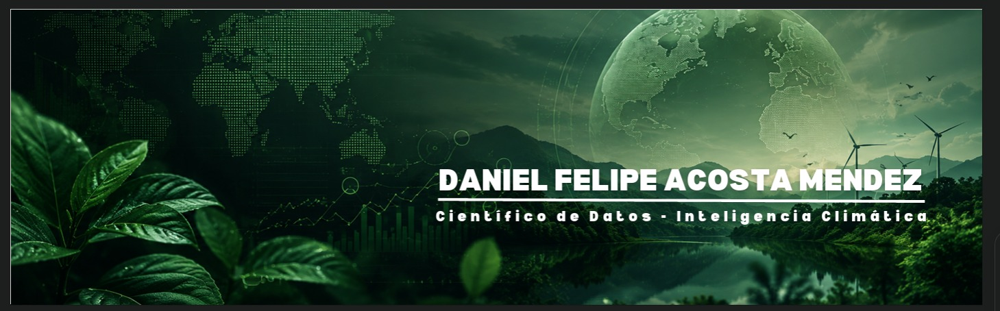
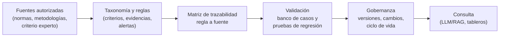
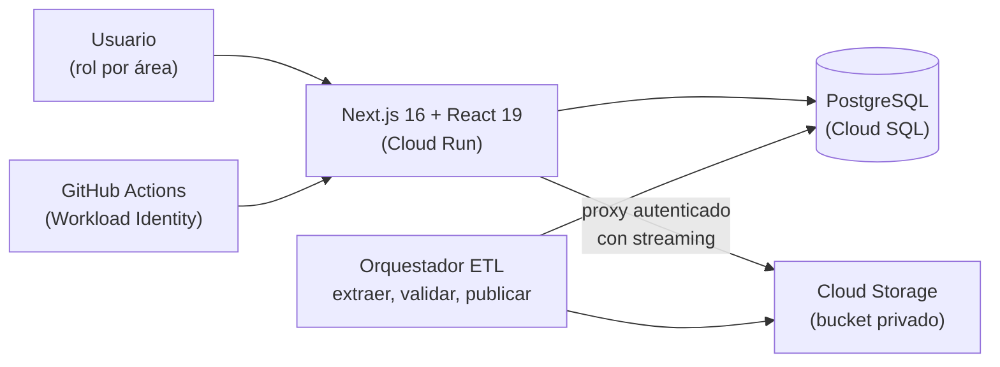
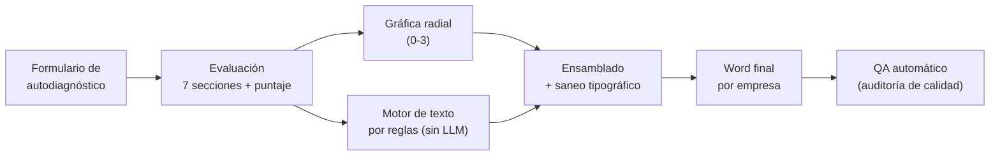
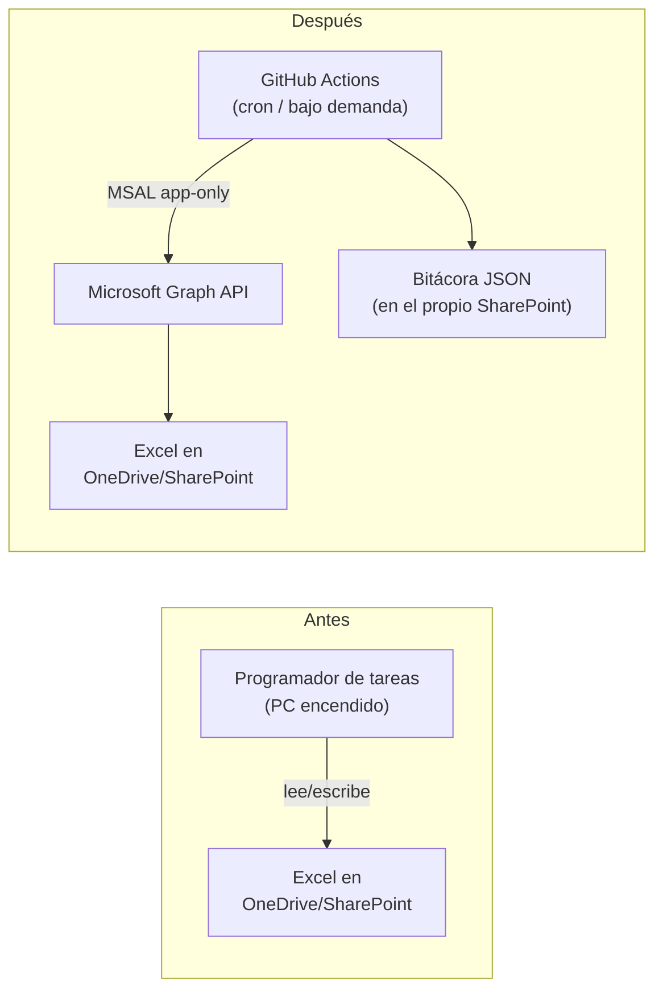
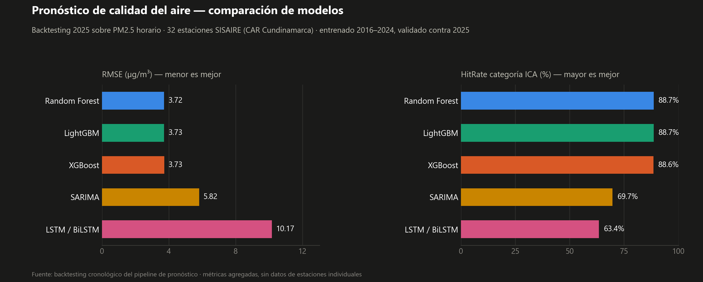
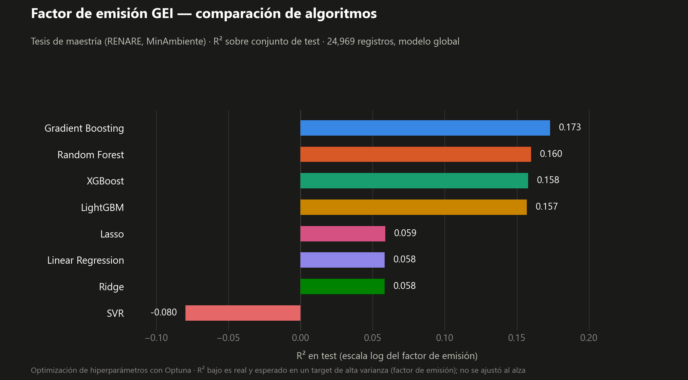
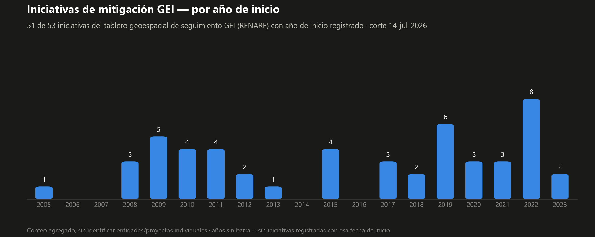

<b>Datos, IA y gobernanza de la información para clima, sostenibilidad y finanzas</b>

  <a href="#-sobre-mí">Sobre mí</a> ·
  <a href="#-proyectos-destacados">Proyectos destacados</a> ·
  <a href="#-banca-y-finanzas">Banca y finanzas</a> ·
  <a href="#-tech-stack">Tech Stack</a> ·
  <a href="#-skills-dónde-los-aplico">Skills</a> ·
  <a href="#-github-stats">GitHub Stats</a>

## 🔎 Perfil en una vista

| Dominio | Qué aporto | Evidencia en este perfil |
|---|---|---|
| 🌍 **Ambiental y climático** | Registro nacional de **iniciativas de mitigación de GEI** (REDD+, MDL, MDL PoA, PBDC, NAMA), **créditos de carbono** y mercado voluntario, MRV, calidad del aire, vulnerabilidad climática, áreas protegidas | Registro de iniciativas de mitigación, pronóstico de calidad del aire, tableros territoriales |
| ⚖️ **Política y normativa** | Participación en la **modificación de la Resolución 1447 de 2018** y de la resolución del **componente de salvaguardas ambientales y sociales**; protocolos, guías y circulares del registro; normativa de calidad del aire llevada a operación; aportes a un plan de descontaminación; atención de PQR | Registro de iniciativas, plan de descontaminación del aire, librería `Estadistica_Ambiental` |
| 🤝 **Impacto social y territorial** | Programas de emprendimiento rural de mujeres y de economía circular para MiPymes, población y vulnerabilidad municipal, devolución de datos a productores | Programas sociales y de economía circular, tableros territoriales |
| 🏦 **Banca y finanzas** | Experiencia en el sector bancario; habilidades en presupuesto y compras, seguimiento contractual, mercado de carbono y control interno | [Banca y finanzas](#-banca-y-finanzas) |
| 🛠️ **Ingeniería de datos** | ETL, pipelines idempotentes, nube (Google Cloud y AWS), CI/CD, calidad y trazabilidad de datos | Portal en Google Cloud, migración a la nube, gestión del conocimiento |
| 📈 **Ciencia de datos e IA** | Series de tiempo, ML interpretable, validación rigurosa, bases de conocimiento y consulta con LLM/RAG | Tesis de maestría, pronóstico PM2.5, librería con más de 700 pruebas |

### 🌐 English summary

**Data scientist and environmental engineer (M.Sc. in Data Science)** working at the intersection of climate, sustainability and data. I build reproducible, traceable data systems: forecasting and ML models, ETL pipelines, knowledge bases, and secure dashboards in production on Google Cloud.

- **Environmental & climate:** administered RENARE, Colombia's national registry of GHG mitigation initiatives (REDD+, CDM, CDM PoA, PBDC, NAMA), at the Ministry of Environment (2024 to 2026): initiative lifecycle and phase changes, REDD+ design-document review, carbon-credit data quality and voluntary carbon market analysis; ML models on registry data supporting BTR and NDC follow-up processes.
- **Policy & regulation:** contributed to the amendment of Resolution 1447 (2018) and of the resolution on the environmental and social safeguards component; applied registry protocols, technical guides and circulars; operationalized air-quality standards (Res. 2254/2017) into forecasts and alert levels; encoded key air, drinking-water and wastewater standards (Res. 2254/2017, 2115/2007, 631/2015) as tested code in an open-source PyPI library (`estadistica-ambiental`); drafted a component of an air-pollution abatement plan for a rural area declared a pollution source area.
- **Social impact:** data and automation for a rural women's entrepreneurship program and a circular-economy program for 300+ SMEs; data return to farmers.
- **Data engineering:** idempotent pipelines, Microsoft Graph and GitHub Actions automation, a private role-based dashboard portal on Google Cloud Run / Cloud SQL, AWS (Glue, Athena, S3) and BigQuery.
- **Data science & AI:** PM2.5 forecasting across 32 stations (SARIMA, tree ensembles, LSTM), an interpretable GHG emission-factor model (SHAP/LIME), and knowledge bases built for traceability and LLM/RAG querying.
- **Banking & finance:** data requirements, quality and conformance testing at Banco de Bogotá via NTT DATA (DAMA, SQL/Oracle, DataStage, Control-M, J-SOX); budgeting and procurement automation, contract-monitoring dashboards, and reconciliation of issued and retired carbon-credit volumes. See the "Banca y finanzas" section.

Projects below are described in Spanish; project-level client details are deliberately omitted. Contact: see the badges above.

---

## 👋 Sobre mí

- 📊 Soy Magíster en Ciencia de Datos, Especialista en Dirección y Gestión de Proyectos TI e Ingeniero Ambiental, apasionado por transformar datos complejos en información estratégica que apoye la toma de decisiones y genere impacto en sostenibilidad, cambio climático y gestión ambiental.
- 💡 He desarrollado soluciones de analítica de datos, Machine Learning, procesos ETL, automatización de flujos de información e ingeniería de datos, aplicadas a iniciativas de mitigación del cambio climático, MRV, mercados de carbono, calidad del aire, ordenamiento territorial y sistemas de información ambiental.
- 🌱 Mi experiencia integra el conocimiento ambiental con la ciencia de datos para diseñar modelos predictivos, optimizar procesos y fortalecer la gobernanza de la información mediante estándares de calidad, trazabilidad, interoperabilidad y seguridad.
- ☁️ También cuento con experiencia en arquitecturas de datos en la nube, trabajando con AWS (Glue, Athena, Amazon S3) y Google Cloud Platform (BigQuery y Google Earth Engine), además de Data Lakes, Big Data, analítica geoespacial, visualización de datos e Inteligencia Artificial Generativa (LLMs).
- 🌍 Mi trabajo reciente se ha enfocado en el desarrollo de soluciones que contribuyen a la transparencia climática, fortaleciendo procesos relacionados con la CMNUCC, el Informe Bienal de Transparencia (BTR) y el seguimiento de la NDC de Colombia, mediante el uso de datos, analítica avanzada e inteligencia climática.
- 🚀 Me motiva participar en proyectos donde la ciencia de datos, la ingeniería de datos y la inteligencia artificial se conviertan en herramientas para resolver retos ambientales, impulsar la innovación y generar valor para las organizaciones y la sociedad.
- 📫 **Contáctame:** [LinkedIn](https://www.linkedin.com/in/danielm-datascientist/) · danielmendez19960@gmail.com

🧭 <b>Trayectoria profesional</b> (clic para expandir)

 

| Periodo | Rol | Organización |
|---|---|---|
| Jun 2024 – Sep 2026 | Analista de Datos y administrador de RENARE (registro nacional de iniciativas de mitigación de GEI y créditos de carbono): ciclo de vida de iniciativas, calidad de datos, aportes normativos, ML para inteligencia climática | Ministerio de Ambiente y Desarrollo Sostenible |
| 2026 | Analítica de Datos y Automatización Documental (Consultoría) | 9Alliance |
| Ene 2026 – Jun 2026 | Analista de Datos (Consultoría): modelos predictivos de calidad del aire, dashboards | CAR Cundinamarca |
| Jun 2025 – Mar 2026 | Analista de Datos: ETL y reportería en Power BI | Solidaridad |
| Nov 2023 – Feb 2024 | Gerente de Calidad / Auditor de Proyectos | NTT DATA |
| Ene 2023 – Sep 2023 | Analista Funcional / PMO | NTT DATA (Banco de Bogotá) |
| Oct 2022 – Mar 2024 | Líder de Proyecto | Alcaldía de Suba |
| Nov 2021 – Dic 2022 | Coordinador de Calidad y Líder de TI | Newrona |

**Formación:** Maestría en Ciencia de Datos, Pontificia Universidad Javeriana (2026) · Especialización en Gerencia de Proyectos de TI, Universidad Internacional de La Rioja (2024) · Ingeniería Ambiental, Universidad Antonio Nariño (2021) · Tecnólogo en Gestión de la Calidad, SENA (2021)

**Certificaciones:** Scrum Master, Product Owner, Team Developer, Design Thinking y Lean Six Sigma Fundamentos (Certiprof, 2023) · J-SOX (Banco de Bogotá, 2023)

---

## 📌 Proyectos destacados

Una mezcla de un **repo público** (código abierto, con CI/tests/documentación) y **proyectos profesionales** desarrollados para entidades del sector ambiental colombiano. Los detalles de clientes/contratos se omiten deliberadamente; lo que sigue es el problema técnico, la arquitectura y el resultado.

### 🌎 RENARE: registro nacional de iniciativas de mitigación de GEI y créditos de carbono (Ministerio de Ambiente)

Administré el registro nacional donde se inscriben y hacen seguimiento las **iniciativas de mitigación de gases de efecto invernadero** del país (**REDD+, MDL, MDL PoA, PBDC, NAMA** y otras), con **cientos de expedientes** y su relación con el **mercado voluntario de carbono**. El reto de fondo es que cada reducción o remoción y cada **crédito de carbono** quede registrado una sola vez, con evidencia y trazabilidad, para evitar el doble conteo.

- **Política y regulación:** participé en la **modificación de la Resolución 1447 de 2018**, que reglamenta el registro y el sistema de monitoreo, reporte y verificación de acciones de mitigación, y de la **resolución que desarrolla el componente de salvaguardas ambientales y sociales**.
- **Ciclo de vida de las iniciativas:** aplicación del protocolo de gestión de cambios de fase (factibilidad, formulación e implementación), guía técnica de factibilidad y circular REDD+ con revisión de documentos de diseño de proyecto (PDD), con matrices por tipo de iniciativa.
- **Calidad de datos de un registro oficial:** depuración de traslapes de polígonos, reglas de precedencia entre fuentes geoespaciales y medición de cobertura. En un cruce con listados del mercado voluntario eliminé los códigos duplicados y los falsos positivos, y corregí sobreconteos de entre 10% y 12% en cantidades emitidas y retiradas de créditos.
- **Inteligencia sobre el mercado:** ETL y tableros autocontenidos (mapas sin internet, fichas por iniciativa, comparadores) para iniciativas de mitigación y mercado voluntario, y un tablero con su ETL y pruebas para el registro de operaciones de emisiones.
- **Atención y gobernanza:** respuesta a peticiones (PQR) con plantilla oficial y doctrina acumulada, historias de usuario, pruebas funcionales y documentación para la migración del registro a otra entidad.
- **Portal seguro en la nube:** acceso revocable con permisos por tema y protección de datos personales (Ley 1581 de 2012), en la misma línea de seguridad del "Portal privado de tableros en Google Cloud".
- **Inteligencia climática:** modelos de ML sobre los datos del registro (ver el modelo de factor de emisión en "Más proyectos") que apoyan el seguimiento de la NDC y el Informe Bienal de Transparencia.

### 🧠 Gestión del conocimiento, trazabilidad y gobernanza de datos

Diseño bases de conocimiento donde **cada regla, criterio o respuesta se puede rastrear hasta su fuente**, y donde el conocimiento no depende de una herramienta ni de un modelo de IA concretos: se guarda en formatos abiertos, versionados y verificables, y la capa de consulta (incluido un enfoque LLM/RAG) es reemplazable.

- **Normativa como código:** las resoluciones colombianas de calidad del aire, agua y vertimientos viven en una librería probada (más de 700 pruebas) con 20 registros de decisiones de arquitectura (ADR) que justifican cada criterio metodológico.
- **Captura de conocimiento tácito:** base de conocimiento en Obsidian (cientos de notas por entidad, mapas de contenido y enlaces) generada por código, con un protocolo para que cada profesional documente su conocimiento mediante una entrevista guiada por su propia IA y deje una nota estructurada y trazable.
- **Trazabilidad celda a campo:** diccionario de datos que enlaza cada indicador de un tablero con su campo y su fuente, y comparaciones byte a byte entre versiones locales y en la nube.
- **Validación repetible:** pruebas "golden" (resultado esperado), auditorías por rondas y revisión en paralelo con agentes de IA de solo lectura que detectaron riesgos antes de publicar.
- **Gobernanza del cambio:** registro de cambios con carpetas fechadas y cierres diarios, publicación que nunca borra lo ya publicado y versiones anteriores conservadas.

**Cómo se corresponde con un proyecto de base de conocimiento**

| Componente | Qué hice | Evidencia |
|---|---|---|
| Fuentes autorizadas y vigencia | Normativa colombiana centralizada en código y análisis de vigencia de la Res. 2254/2017 | Librería [`Estadistica_Ambiental`](https://github.com/DanMendezZz/Estadistica_Ambiental) |
| Taxonomía y modelo conceptual | 17 líneas temáticas ambientales con categorías, reglas y criterios de decisión | Librería y su documentación publicada |
| Modelo de conocimiento | Normas y criterios como código reutilizable, en formatos abiertos | Librería en PyPI |
| Trazabilidad | Cada criterio metodológico ligado a una decisión documentada (ADR) y cada indicador a su campo y fuente | 20 ADRs (público); diccionario de datos (proyecto profesional) |
| Validación y calidad | Más de 700 pruebas, pruebas de resultado esperado, auditorías por rondas | CI público de la librería |
| Gobernanza y ciclo de vida | Control de cambios, versiones y publicación sin borrado | Registro de cambios con cierres diarios (proyecto profesional) |
| Consulta | Documentación publicada y notebooks navegables sin instalar nada | [Documentación](https://danmendezzz.github.io/Estadistica_Ambiental/) |

### 📦 [`Estadistica_Ambiental`](https://github.com/DanMendezZz/Estadistica_Ambiental): librería de ciencia de datos ambiental (PyPI)

Base de conocimiento + librería reutilizable (`pip install estadistica-ambiental`) que cubre el **ciclo estadístico completo** (EDA, descriptiva, inferencial, modelado predictivo y reporte de cumplimiento normativo) para **17 líneas temáticas ambientales** (calidad del aire, oferta hídrica, páramos, humedales, cambio climático, etc.), con la normativa colombiana (Res. 2254/2017, 2115/2007, 631/2015) centralizada en código en vez de hardcodeada por script.

- Más de 700 tests, ~84% cobertura, CI en Linux + Windows, documentación auto-publicada (mkdocs-material) y notebooks navegables **sin instalar nada** vía JupyterLite/Pyodide.
- 20 ADRs documentando decisiones metodológicas (por qué ADF+KPSS obligatorio antes de ARIMA, por qué los outliers ambientales se tratan como señal real y no se descartan, lag hidrológico de ENSO por ecosistema, etc.).
- Validado sobre datos reales: el módulo de calidad del aire alcanzó **RMSE 3.72 µg/m³ y HitRate ICA 88.6%** sobre series horarias de PM2.5, replicado de forma independiente en el proyecto hermano de pronóstico de calidad del aire (ver "Más proyectos").

### 🌐 Portal privado de tableros en Google Cloud (consultoría, autoridad ambiental regional)

Aplicación web full-stack, en producción, que reemplaza el envío de tableros por correo: cada área de la entidad entra con su usuario y ve únicamente sus tableros (calidad del aire, áreas protegidas, vulnerabilidad climática, población, seguimiento contractual), con resumen ejecutivo, mapa coroplético por municipio y alertas.

- **Seguridad por defecto:** contraseñas con Argon2id, sesiones opacas y revocables guardadas en base de datos, bloqueo por intentos fallidos, *rate limit*, auditoría de accesos, CSP con *nonce* por solicitud y lista de rutas permitidas en el middleware/proxy de la aplicación.
- **CI/CD sin llaves:** despliegue desde GitHub Actions con Workload Identity Federation (sin JSON de credenciales), secretos en Secret Manager, imágenes en Artifact Registry y detección de secretos (gitleaks) en cada cambio.
- **Publicación segura de datos:** el orquestador ETL valida cada conjunto de datos antes de publicar, tiene modo simulación con diff, nunca borra lo ya publicado y conserva la generación anterior. Los indicadores llevan fecha de corte y estado explícito ("sin dato" con motivo) en vez de inventar valores, y el cruce de nombres de municipios contra la codificación oficial DIVIPOLA (DANE) falla de forma explícita cuando no hay coincidencia.

📚 <b>Más proyectos</b> (clic para expandir)

 

### 🤝 Programas sociales y de economía circular (consultoría)

Tres frentes con propósito social y ambiental donde la ingeniería de datos reemplaza procesos manuales y deja **trazabilidad para la interventoría**:

- **Emprendimiento rural de mujeres:** apoyo a más de cien organizaciones y mujeres rurales en varias regiones del país, con enfoque diferencial (población víctima, afro e indígena). Automaticé el ciclo de diagnóstico, plan de fortalecimiento y plan de activos, y un **pipeline de compras** con cotizaciones comparadas, validación de IVA por línea, órdenes de compra, topes de financiación, verificación de contrapartida y prevalidación documental con semáforo, para reducir devoluciones de la interventoría. Incluye cumplimiento de habeas data (Ley 1581 de 2012).
- **Economía circular para MiPymes de Bogotá:** más de 300 diagnósticos con rúbrica de siete dimensiones y clasificación de madurez (de "lineal tradicional" a "regenerativa", el mismo programa del motor documental que se describe más abajo), análisis de cadena de valor (Porter), planes de gestión ambiental con acciones priorizadas y trazabilidad verificable por hash, y cápsulas de formación en tres niveles, con una base de conocimiento ligada a las palancas de economía circular y a la clasificación 9R.
- **Devolución de datos a productores agrícolas (ONG):** ETL en Python que convierte encuestas de campo en infografías individuales para cada productor.

### 🏭 Motor de automatización documental por reglas (consultoría, programa de fortalecimiento empresarial)

Pipeline que genera, para cada empresa participante de un programa de fortalecimiento empresarial con enfoque en economía circular, un **informe técnico de diagnóstico en Word** a partir de un formulario de autodiagnóstico, sin ninguna llamada a LLM/API: puntuación + clasificación de madurez, gráfica radial y **texto narrativo generado por un motor de reglas determinista** (normalización de voz a 3ª persona, límites de repetición, ajuste de contenido según la clasificación obtenida).

- **+300 documentos generados en lote**, 0 errores en la auditoría automática de calidad (detección de placeholders, resaltados residuales, lenguaje en 1ª persona, puntuación, mayúsculas fugadas).
- Motor de reglas 100% determinista y auditable: mismo input → mismo output, sin riesgo de alucinación ni de exponer datos a un proveedor externo.
- Flujo **separado** de **actas asistido por agente LLM** (fuera del motor de informes, que sigue sin LLM ni proveedores externos), con compuertas de control: solo se genera con los insumos completos, tiene tope de reintentos y revisión visual del PDF resultante.
- Capa de "limpieza tipográfica" que normaliza texto libre de formulario (MAYÚSCULAS, tildes rotas, palabras duplicadas) contra un maestro de razón social, sin intervención manual.

### 🗺️ Tablero de control + modelo de asignación de visitas (consultoría, mismo programa)

Tablero HTML autocontenible (Chart.js + Leaflet, sin backend) que unifica **cientos de empresas** en un solo panel: KPIs, correlaciones, ficha 360° por empresa y planeación geográfica de visitas de campo. Incluye un **modelo de asignación** que empareja profesional↔empresa↔horario por cercanía (fórmula de Haversine) respetando disponibilidad declarada por día, con balanceo de carga entre el equipo, y expone cada ruta diaria con un enlace directo a Google Maps.

### ☁️ Migración de automatizaciones locales a la nube (GitHub Actions + Microsoft Graph API)

Diseño y documentación de un patrón reutilizable para migrar jobs que corrían en el Programador de tareas de un PC (leyendo/escribiendo Excel en SharePoint/OneDrive) a **GitHub Actions con autenticación app-only vía Microsoft Graph**, eliminando la dependencia de un equipo encendido y el riesgo de archivos en conflicto porque el equipo los tenía abiertos.

- Capa de I/O reutilizable con reintentos ante *rate-limiting* de Graph (429/5xx) y una distinción explícita entre "archivo no existe" (404) y error transitorio, lo que evita sobrescrituras accidentales de datos reales.
- Validación **byte a byte** del job migrado contra el job local antes de apagar el original; bitácora de ejecución persistida en la nube (no en el runner efímero).
- Ejecución **incremental e idempotente** (hash por fila, publicación documento por documento, presupuesto de minutos de Actions) y guardias contra corridas "verdes pero inútiles": topes de archivos retirados o degradados que abortan la ejecución y una guardia de regresión frente a la corrida anterior.
- Playbook documentado para que el mismo patrón se replique en cualquier otro proceso del mismo tipo.

### 🌫️ Sistema de pronóstico de calidad del aire (consultoría, autoridad ambiental regional)

Pipeline ML de extremo a extremo sobre la red oficial de monitoreo de calidad del aire (PM2.5 horario, 2016–2026, 32 estaciones activas tras control de calidad): ETL con detección de outliers espacio-temporalmente confirmados, imputación sin fuga de información (interpolación + KNN), ingeniería de variables (lags, rolling, componentes cíclicos, índice climático ENSO/ONI), y comparación de **SARIMA, Random Forest, XGBoost, LightGBM y LSTM/BiLSTM** con optimización bayesiana de hiperparámetros (Optuna) y *backtesting* walk-forward.

- Reportes ejecutivos **autocontenidos** (HTML/R Markdown, un solo archivo, sin dependencias externas) con mapa interactivo del índice de calidad del aire y semáforo de cumplimiento normativo (Res. 2254/2017).
- **En producción:** modelos por estación (conjunto de Random Forest, XGBoost y LightGBM, con corrección AR(1) sobre residuos), reentrenamiento trimestral programado y chequeo automático de anomalías; el mismo esquema opera también para PM10.
- **Del dato a la política:** operacionalicé la Resolución 2254/2017 (niveles de Prevención, Alerta y Emergencia para PM2.5) en pronósticos por estación, conteo de días de excedencia e ICA rural, y redacté el componente de prevención de estados excepcionales y fortalecimiento del sistema de vigilancia, junto con un diagnóstico de calidad del aire, para el plan de descontaminación de una zona rural declarada área-fuente (como contribución a un plan en construcción).
- **Dimensión territorial y social:** tableros para una jurisdicción de más de cien municipios: población (proyecciones DANE), vulnerabilidad climática en 7 dimensiones, áreas protegidas, aguas y visitas a campo.
- Además de este pipeline, construí un **framework de generación de dashboards** reutilizado en distintas áreas funcionales de la entidad (áreas protegidas, cambio climático, seguimiento de metas): mismo patrón ETL → validación → KPIs → tablero, con distintas fuentes de datos.

  

*Backtesting cronológico 2025 (entrenado 2016–2024, validado contra 2025) sobre las 32 estaciones activas de la red SISAIRE: los tres modelos de árboles (Random Forest, LightGBM, XGBoost) empatan en desempeño y superan claramente a SARIMA y LSTM tanto en error (RMSE) como en acierto de categoría del Índice de Calidad del Aire (HitRate).*

### 🛰️ Modelo predictivo de factor de emisión de GEI (tesis de maestría, avalada por el Ministerio de Ambiente)

Pipeline de 5 etapas (preprocesamiento → EDA → modelado → interpretabilidad → dashboard) para predecir el factor de emisión de GEI de proyectos registrados en la plataforma RENARE, comparando 8 algoritmos (Linear/Ridge/Lasso, Random Forest, Gradient Boosting, XGBoost, LightGBM, SVR) con **optimización bayesiana vía Optuna** e interpretabilidad con **SHAP/LIME**, servido en un dashboard Streamlit interactivo. En la misma línea de trabajo (seguimiento de iniciativas de mitigación GEI) también construí un dashboard geoespacial **offline** (mapa Leaflet embebido, sin internet) que reconcilia formularios institucionales con documentación técnica georreferenciada (extracción de datos estructurados desde PDF con PyMuPDF, reproyección de coordenadas con GeoPandas/Shapely/Pyproj) para dar trazabilidad a decenas de iniciativas del mercado voluntario de carbono.

  

*R² sobre el conjunto de test (24,969 registros RENARE): los modelos de ensamble de árboles (Gradient Boosting, Random Forest, XGBoost, LightGBM) capturan más señal que la familia lineal (Ridge/Lasso/OLS), y SVR queda por debajo de una línea base. El R² es deliberadamente bajo (es un target de alta varianza) y se muestra sin ajustar al alza.*

  

*Conteo agregado (sin identificar entidades ni proyectos individuales) de las 51 iniciativas de mitigación GEI con año de inicio registrado, de un total de 53 trazadas en el dashboard geoespacial (un subconjunto del mercado voluntario).*

---

## 🏦 Banca y finanzas

<table>
<tr>
<td width="50%" valign="top">

**Experiencia en el sector bancario**

*Banco de Bogotá, a través de NTT DATA (2023) · Analista Funcional / PMO*

- Modelado, priorización y validación de **requisitos de datos** de clientes y usuarios.
- Revisión de flujos de datos con **IBM DataStage y Control-M**; validación en **SQL y Oracle**.
- Diseño y ejecución de **pruebas de conformidad**; historias de usuario y diagramas de flujo.
- Aplicación del marco **DAMA** de gobierno de datos y seguimiento de incidencias de calidad y disponibilidad.
- Certificación **J-SOX** (control interno financiero), Banco de Bogotá, 2023.

</td>
<td width="50%" valign="top">

**Habilidades económicas y financieras**

- **Presupuesto y compras:** comparación de cotizaciones, validación de IVA por línea, topes de financiación, contrapartidas y órdenes de compra.
- **Seguimiento contractual y finanzas públicas:** tableros de seguimiento de contratos, convenios y liquidaciones.
- **Mercado de carbono:** control de cantidades emitidas y retiradas de créditos, doble conteo y calidad de los registros.
- **Control interno y trazabilidad:** J-SOX, auditoría de datos y pruebas automatizadas.
- **Indicadores financieros y reportería:** seguimiento de indicadores financieros sobre **SAP ERP** como auditor de proyectos (NTT DATA, 2023 a 2024), consolidación de información para facturación y reportería en Power BI.

</td>
</tr>
</table>

---

## 🧰 Tech Stack

**AWS**

**Google Cloud Platform**

🧩 <b>Resto del stack</b> (clic para expandir)

 

**Lenguajes**

**Ciencia de Datos y Machine Learning**

**IA Generativa y Gestión del Conocimiento**

**Big Data**

**Visión y procesamiento de documentos**

**BI y Visualización**

**Desarrollo web y APIs**

**Bases de datos**

**Geoespacial**

**DevOps y Automatización**

**Gestión de proyectos y procesos**

---

## 🎯 Skills: dónde los aplico

| Dominio | Herramientas principales | Evidencia real |
|---|---|---|
| Modelado predictivo / series de tiempo | SARIMA, Prophet, XGBoost, LightGBM, Random Forest, LSTM, Optuna | Pronóstico de calidad del aire (32 estaciones); factor de emisión GEI (tesis); ARIMA sobre iniciativas de mitigación |
| Estadística aplicada | ADF/KPSS, Mann-Kendall, Sen's slope, pruebas de hipótesis | Librería `estadistica-ambiental` (17 líneas temáticas, 20 ADRs metodológicos) |
| Interpretabilidad de modelos | SHAP, LIME, importancia de variables | Tesis de maestría: factor de emisión GEI |
| Automatización documental sin LLM | Motores de reglas deterministas, `python-docx`, control de calidad automatizado | +300 informes técnicos generados en lote, 0 errores en la auditoría automática |
| Dashboards autocontenibles | Leaflet, Chart.js, Plotly, HTML/JSON embebido, R Markdown | Tablero de control multi-empresa; mapa GEI offline; reportes ejecutivos SISAIRE |
| Gestión del conocimiento y gobernanza | Taxonomías, matrices de trazabilidad, ADRs, Obsidian, versionamiento, control de cambios, LLM/RAG | Base de conocimiento trazable, librería normativa, diccionario de datos con trazabilidad celda a campo |
| Dominio ambiental y normativo | RENARE, REDD+, MDL y MDL PoA, MRV, NDC y BTR, Res. 1447 de 2018, salvaguardas ambientales y sociales, Res. 2254/2017, 2115/2007, 631/2015, Ley 1581 de 2012 | Seguimiento de iniciativas GEI, cumplimiento normativo codificado |
| Banca y finanzas | DAMA, SQL y Oracle, IBM DataStage, Control-M, pruebas de conformidad, J-SOX, presupuesto y compras, seguimiento contractual | Proyecto de datos en Banco de Bogotá (2023), automatización de compras y de seguimiento contractual |
| Ingeniería en la nube | GitHub Actions, Microsoft Graph API (MSAL, app-only), reintentos/idempotencia | Migración de jobs locales a la nube, patrón reutilizable documentado |
| Procesamiento geoespacial | GeoPandas, Shapely, Pyproj, reproyección de coordenadas, simplificación de geometrías | Mapa de iniciativas GEI; cartografía SISAIRE (municipios/localidades) |
| BI / reportería | Power BI, Streamlit, ETL a medida | Reportes RENARE, dashboards Streamlit, ETL/BI para seguimiento de impacto |

---

## 📊 GitHub Stats

<!-- Stats, Trophy y Activity Graph corren en instancias propias de Vercel,
     no en los despliegues públicos compartidos (que se pausan por cuota o se suspenden).
     Streak stats sigue en su servicio público porque está arriba. -->

