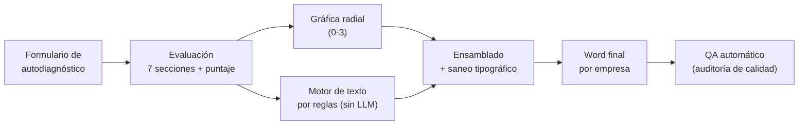
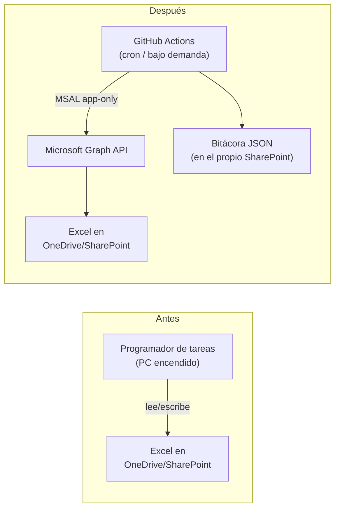

  <a href="#-sobre-mí">Sobre mí</a> ·
  <a href="#-proyectos-destacados">Proyectos destacados</a> ·
  <a href="#-tech-stack">Tech Stack</a> ·
  <a href="#-skills-dónde-los-aplico">Skills</a> ·
  <a href="#-github-stats">GitHub Stats</a>

## 👋 Sobre mí

- 📊 Soy Magíster en Ciencia de Datos, Especialista en Dirección y Gestión de Proyectos TI e Ingeniero Ambiental, apasionado por transformar datos complejos en información estratégica que apoye la toma de decisiones y genere impacto en sostenibilidad, cambio climático y gestión ambiental.
- 💡 He desarrollado soluciones de analítica de datos, Machine Learning, procesos ETL, automatización de flujos de información e ingeniería de datos, aplicadas a iniciativas de mitigación del cambio climático, MRV, mercados de carbono, calidad del aire, ordenamiento territorial y sistemas de información ambiental.
- 🌱 Mi experiencia integra el conocimiento ambiental con la ciencia de datos para diseñar modelos predictivos, optimizar procesos y fortalecer la gobernanza de la información mediante estándares de calidad, trazabilidad, interoperabilidad y seguridad.
- ☁️ También cuento con experiencia en arquitecturas de datos en la nube, trabajando con AWS (Glue, Athena, Amazon S3) y Google Cloud Platform (BigQuery y Google Earth Engine), además de Data Lakes, Big Data, analítica geoespacial, visualización de datos e Inteligencia Artificial Generativa (LLMs).
- 🌍 Actualmente enfoco mi trabajo en el desarrollo de soluciones que contribuyen a la transparencia climática, fortaleciendo procesos relacionados con la CMNUCC, el Informe Bienal de Transparencia (BTR) y el seguimiento de la NDC de Colombia, mediante el uso de datos, analítica avanzada e inteligencia climática.
- 🚀 Me motiva participar en proyectos donde la ciencia de datos, la ingeniería de datos y la inteligencia artificial se conviertan en herramientas para resolver retos ambientales, impulsar la innovación y generar valor para las organizaciones y la sociedad.
- 📫 **Contáctame:** [LinkedIn](https://www.linkedin.com/in/danielm-datascientist/) · danielmendez19960@gmail.com

🧭 <b>Trayectoria profesional</b> (clic para expandir)

 

| Periodo | Rol | Organización |
|---|---|---|
| Jun 2024 – Actualidad | Analista de Datos: plataforma RENARE, ML para inteligencia climática, ETL ambiental | Ministerio de Ambiente y Desarrollo Sostenible |
| 2026 | Analítica de Datos y Automatización Documental (Consultoría) | 9Alliance |
| Ene 2026 – Jun 2026 | Analista de Datos (Consultoría): modelos predictivos de calidad del aire, dashboards | CAR Cundinamarca |
| Jun 2025 – Mar 2026 | Analista de Datos: ETL y reportería en Power BI | Solidaridad |
| Nov 2023 – Feb 2024 | Gerente de Calidad / Auditor de Proyectos | NTT DATA |
| Ene 2023 – Sep 2023 | Analista Funcional / PMO | NTT DATA (Banco de Bogotá) |
| Oct 2022 – Mar 2024 | Líder de Proyecto | Alcaldía de Suba |
| Nov 2021 – Dic 2022 | Coordinador de Calidad y Líder de TI | Newrona |

**Formación:** Maestría en Ciencia de Datos, Pontificia Universidad Javeriana (2026) · Especialización en Gerencia de Proyectos de TI, Universidad Internacional de La Rioja (2024) · Ingeniería Ambiental, Universidad Antonio Nariño (2021) · Tecnólogo en Gestión de la Calidad, SENA (2021)

---

## 📌 Proyectos destacados

Una mezcla de un **repo público** (código abierto, con CI/tests/documentación) y **proyectos profesionales** desarrollados para entidades del sector ambiental colombiano. Los detalles de clientes/contratos se omiten deliberadamente; lo que sigue es el problema técnico, la arquitectura y el resultado.

### 📦 [`Estadistica_Ambiental`](https://github.com/DanMendezZz/Estadistica_Ambiental): librería de ciencia de datos ambiental (PyPI)

Base de conocimiento + librería reutilizable (`pip install estadistica-ambiental`) que cubre el **ciclo estadístico completo** (EDA, descriptiva, inferencial, modelado predictivo y reporte de cumplimiento normativo) para **17 líneas temáticas ambientales** (calidad del aire, oferta hídrica, páramos, humedales, cambio climático, etc.), con la normativa colombiana (Res. 2254/2017, 2115/2007, 631/2015) centralizada en código en vez de hardcodeada por script.

- Más de 700 tests, ~84% cobertura, CI en Linux + Windows, documentación auto-publicada (mkdocs-material) y notebooks navegables **sin instalar nada** vía JupyterLite/Pyodide.
- 20 ADRs documentando decisiones metodológicas (por qué ADF+KPSS obligatorio antes de ARIMA, por qué los outliers ambientales se tratan como señal real y no se descartan, lag hidrológico de ENSO por ecosistema, etc.).
- Validado sobre datos reales: el módulo de calidad del aire alcanzó **RMSE 3.72 µg/m³ y HitRate ICA 88.6%** sobre series horarias de PM2.5, replicado de forma independiente en el proyecto hermano de pronóstico de calidad del aire (ver más abajo).

### 📊 [`Estadistica_Ambiental_Dashboard`](https://github.com/DanMendezZz/Estadistica_Ambiental_Dashboard): dashboard satélite (Streamlit Cloud)

Demo pública desplegada en Streamlit Community Cloud que consume la librería anterior **solo como dependencia** (sin reimplementar lógica): calidad de datos → descriptiva → tendencia (Mann-Kendall) → reporte de excedencias normativas, sobre PM2.5 horario. Ilustra el patrón "librería base + apps satélite" que uso para separar investigación reutilizable de productos de cliente.

### 🏭 Motor de automatización documental por reglas (consultoría, programa de fortalecimiento empresarial)

Pipeline que genera, para cada empresa participante de un programa de fortalecimiento empresarial con enfoque en economía circular, un **informe técnico de diagnóstico en Word** a partir de un formulario de autodiagnóstico, sin ninguna llamada a LLM/API: puntuación + clasificación de madurez, gráfica radial y **texto narrativo generado por un motor de reglas determinista** (normalización de voz a 3ª persona, límites de repetición, ajuste de contenido según la clasificación obtenida).

- **+300 documentos generados en lote**, 0 errores en la auditoría automática de calidad (detección de placeholders, resaltados residuales, lenguaje en 1ª persona, puntuación, mayúsculas fugadas).
- Motor de reglas 100% determinista y auditable: mismo input → mismo output, sin riesgo de alucinación ni de exponer datos a un proveedor externo.
- Capa de "limpieza tipográfica" que normaliza texto libre de formulario (MAYÚSCULAS, tildes rotas, palabras duplicadas) contra un maestro de razón social, sin intervención manual.

### 🗺️ Tablero de control + modelo de asignación de visitas (consultoría, mismo programa)

Tablero HTML autocontenible (Chart.js + Leaflet, sin backend) que unifica **cientos de empresas** en un solo panel: KPIs, correlaciones, ficha 360° por empresa y planeación geográfica de visitas de campo. Incluye un **modelo de asignación** que empareja profesional↔empresa↔horario por cercanía (fórmula de Haversine) respetando disponibilidad declarada por día, con balanceo de carga entre el equipo, y expone cada ruta diaria con un enlace directo a Google Maps.

### ☁️ Migración de automatizaciones locales a la nube (GitHub Actions + Microsoft Graph API)

Diseño y documentación de un patrón reutilizable para migrar jobs que corrían en el Programador de tareas de un PC (leyendo/escribiendo Excel en SharePoint/OneDrive) a **GitHub Actions con autenticación app-only vía Microsoft Graph**, eliminando la dependencia de un equipo encendido y el riesgo de archivos en conflicto porque el equipo los tenía abiertos.

- Capa de I/O reutilizable con reintentos ante *rate-limiting* de Graph (429/5xx) y una distinción explícita entre "archivo no existe" (404) y error transitorio, lo que evita sobrescrituras accidentales de datos reales.
- Validación **byte a byte** del job migrado contra el job local antes de apagar el original; bitácora de ejecución persistida en la nube (no en el runner efímero).
- Playbook documentado para que el mismo patrón se replique en cualquier otro proceso del mismo tipo.

### 🌫️ Sistema de pronóstico de calidad del aire (consultoría, autoridad ambiental regional)

Pipeline ML de extremo a extremo sobre la red oficial de monitoreo de calidad del aire (PM2.5 horario, 2016–2026, 32 estaciones activas tras control de calidad): ETL con detección de outliers espacio-temporalmente confirmados, imputación sin fuga de información (interpolación + KNN), ingeniería de variables (lags, rolling, componentes cíclicos, índice climático ENSO/ONI), y comparación de **SARIMA, Random Forest, XGBoost, LightGBM y LSTM/BiLSTM** con optimización bayesiana de hiperparámetros (Optuna) y *backtesting* walk-forward.

- Reportes ejecutivos **autocontenidos** (HTML/R Markdown, un solo archivo, sin dependencias externas) con mapa interactivo del índice de calidad del aire y semáforo de cumplimiento normativo (Res. 2254/2017).
- Además de este pipeline, construí un **framework de generación de dashboards** reutilizado en distintas áreas funcionales de la entidad (áreas protegidas, cambio climático, seguimiento de metas): mismo patrón ETL → validación → KPIs → tablero, con distintas fuentes de datos.

  

*Backtesting cronológico 2025 (entrenado 2016–2024, validado contra 2025) sobre las 32 estaciones activas de la red SISAIRE: los tres modelos de árboles (Random Forest, LightGBM, XGBoost) empatan en desempeño y superan claramente a SARIMA y LSTM tanto en error (RMSE) como en acierto de categoría del Índice de Calidad del Aire (HitRate).*

### 🛰️ Modelo predictivo de factor de emisión de GEI (tesis de maestría, avalada por el Ministerio de Ambiente)

Pipeline de 5 etapas (preprocesamiento → EDA → modelado → interpretabilidad → dashboard) para predecir el factor de emisión de GEI de proyectos registrados en la plataforma RENARE, comparando 8 algoritmos (Linear/Ridge/Lasso, Random Forest, Gradient Boosting, XGBoost, LightGBM, SVR) con **optimización bayesiana vía Optuna** e interpretabilidad con **SHAP/LIME**, servido en un dashboard Streamlit interactivo. En la misma línea de trabajo (seguimiento de iniciativas de mitigación GEI) también construí un dashboard geoespacial **offline** (mapa Leaflet embebido, sin internet) que reconcilia formularios institucionales con documentación técnica georreferenciada (extracción de datos estructurados desde PDF con PyMuPDF, reproyección de coordenadas con GeoPandas/Shapely/Pyproj) para dar trazabilidad a decenas de iniciativas del mercado voluntario de carbono.

  

*R² sobre el conjunto de test (24,969 registros RENARE): los modelos de ensamble de árboles (Gradient Boosting, Random Forest, XGBoost, LightGBM) capturan más señal que la familia lineal (Ridge/Lasso/OLS), y SVR queda por debajo de una línea base. El R² es deliberadamente bajo (es un target de alta varianza) y se muestra sin ajustar al alza.*

  

*Conteo agregado (sin identificar entidades ni proyectos individuales) de las 51 iniciativas de mitigación GEI con año de inicio registrado, de un total de 53 trazadas en el dashboard geoespacial.*

---

## 🧰 Tech Stack

**Lenguajes**

**Ciencia de Datos y Machine Learning**

**Nube e Ingeniería de Datos**

-232F3E?style=for-the-badge&logo=amazonaws&logoColor=white)

**Bases de datos**

**Geoespacial**

**BI y Visualización**

**Herramientas y Colaboración**

## 🎯 Skills: dónde los aplico

| Dominio | Herramientas principales | Evidencia real |
|---|---|---|
| Modelado predictivo / series de tiempo | SARIMA, Prophet, XGBoost, LightGBM, Random Forest, LSTM, Optuna | Pronóstico de calidad del aire (32 estaciones); factor de emisión GEI (tesis); ARIMA sobre iniciativas de mitigación |
| Estadística aplicada | ADF/KPSS, Mann-Kendall, Sen's slope, pruebas de hipótesis | Librería `estadistica-ambiental` (17 líneas temáticas, 20 ADRs metodológicos) |
| Interpretabilidad de modelos | SHAP, LIME, importancia de variables | Tesis de maestría: factor de emisión GEI |
| Automatización documental sin LLM | Motores de reglas deterministas, `python-docx`, control de calidad automatizado | +300 informes técnicos generados en lote, 0 errores en la auditoría automática |
| Dashboards autocontenibles | Leaflet, Chart.js, Plotly, HTML/JSON embebido, R Markdown | Tablero de control multi-empresa; mapa GEI offline; reportes ejecutivos SISAIRE |
| Ingeniería en la nube | GitHub Actions, Microsoft Graph API (MSAL, app-only), reintentos/idempotencia | Migración de jobs locales a la nube, patrón reutilizable documentado |
| Procesamiento geoespacial | GeoPandas, Shapely, Pyproj, reproyección de coordenadas, simplificación de geometrías | Mapa de iniciativas GEI; cartografía SISAIRE (municipios/localidades) |
| BI / reportería | Power BI, Streamlit, ETL a medida | Reportes RENARE, dashboards Streamlit, ETL/BI para seguimiento de impacto |

---

## 📊 GitHub Stats

<!-- Stats, Trophy y Activity Graph corren en instancias propias de Vercel,
     no en los despliegues públicos compartidos (que se pausan por cuota o se suspenden).
     Streak stats sigue en su servicio público porque está arriba. -->

